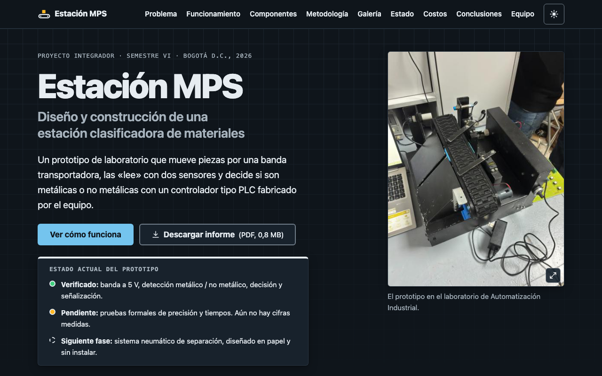
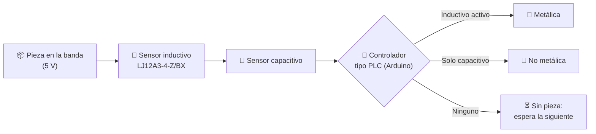

<div align="center">

# 🏭 Estación MPS

### Diseño y construcción de una estación clasificadora de materiales

Página web de portafolio del **Proyecto Integrador** · Tecnología en Automatización Industrial
Universidad de San Buenaventura · Bogotá D.C., 2026


**[🌐 Ver el sitio](https://alejandroibanhez.github.io/PortafolioProyecto/)** ·
**[📄 Descargar el informe](docs/proyecto-integrador-estacion-mps.pdf)** ·
**[🎨 Documentación de diseño](docs/diseno-ux.md)**

<br>

<a href="https://alejandroibanhez.github.io/PortafolioProyecto/">
  
</a>

</div>

---

## 📑 Contenido

- [🔎 Sobre el proyecto](#-sobre-el-proyecto)
- [⚙️ Cómo funciona la estación](#️-cómo-funciona-la-estación)
- [🚦 Estado del prototipo](#-estado-del-prototipo)
- [✨ Características de la web](#-características-de-la-web)
- [🗂️ Estructura de carpetas](#️-estructura-de-carpetas)
- [💻 Cómo verla en local](#-cómo-verla-en-local)
- [🚀 Cómo publicarla en GitHub Pages](#-cómo-publicarla-en-github-pages)
- [👥 Equipo](#-equipo)
- [📜 Licencia y créditos](#-licencia-y-créditos)

---

## 🔎 Sobre el proyecto

La estación es un **prototipo de laboratorio** que clasifica piezas en metálicas y no metálicas. Nació con dos propósitos: automatizar una tarea que a mano es lenta y propensa a errores, y dejar en la universidad un equipo real para que otros estudiantes practiquen automatización.

Esta página resume el informe final del proyecto: el problema, el funcionamiento, los componentes, la metodología, el estado real del prototipo, los costos y las conclusiones.

## ⚙️ Cómo funciona la estación



| Sensor inductivo | Sensor capacitivo | Decisión |
| :---: | :---: | --- |
| ✅ Activo | — | 🔩 Pieza **metálica** |
| ❌ Inactivo | ✅ Activo | 🧱 Pieza **no metálica** |
| ❌ Inactivo | ❌ Inactivo | ⏳ No hay pieza o pasó fuera de rango |

## 🚦 Estado del prototipo

La página presenta el estado real del proyecto, sin exagerarlo.

| Estado | Qué | Detalle |
| :---: | --- | --- |
| 🟢 | **Banda transportadora** | Funciona a 5 V y mueve las piezas de forma continua. |
| 🟢 | **Detección** | Sensor inductivo LJ12A3-4-Z/BX y sensor capacitivo, calibrados. |
| 🟢 | **Decisión y señalización** | Lógica metálico / no metálico en un controlador propio tipo PLC basado en Arduino. |
| 🟡 | **Pruebas formales** | El protocolo de cinco pruebas está propuesto; todavía no hay cifras de precisión ni de tiempos. |
| 🟡 | **Documentación técnica** | Faltan planos y programa completos, y pruebas con más tipos de piezas. |
| ⚪ | **Sistema neumático** | Diseñado en papel y sin instalar. Es la siguiente fase. |

> [!NOTE]
> El controlador es de fabricación propia. No es un PLC industrial certificado.

> [!IMPORTANT]
> Según los diagramas y la tabla de costos de los anexos, el montaje incluye Arduino Mega y Arduino Nano, driver L298N, módulo de 4 relés y dos servomotores MG996R como mecanismo de desvío.

**💰 Costos:** total del proyecto **$2.500.000 COP** (anexo E, valores estimados de referencia). Lista de componentes electrónicos: $223.200 COP.

## ✨ Características de la web

| | Característica | Detalle |
| :---: | --- | --- |
| 📄 | **Sitio estático** | Una sola página en HTML, CSS y JavaScript, sin frameworks ni paso de build. |
| 🌗 | **Tema claro y oscuro** | Sigue la preferencia del sistema y recuerda el cambio manual. |
| 📱 | **Diseño adaptable** | Pensado primero para móvil (probado a 360, 768 y 1280 px), sin scroll horizontal. |
| ♿ | **Accesibilidad WCAG 2.1 AA** | HTML semántico, enlace «Saltar al contenido», foco visible y navegación completa por teclado. |
| 🖼️ | **Galería ampliable** | Lightbox accesible con el elemento `<dialog>` nativo. |
| 📊 | **Contenido propio** | Diagrama SVG del funcionamiento y tablas de lógica, pruebas y costos en HTML. |
| 🔒 | **Sin terceros** | Sin fuentes externas, sin CDN y sin rastreadores. |

## 🗂️ Estructura de carpetas

```text
.
├── index.html                  Página única
├── assets/
│   ├── css/styles.css          Tokens de diseño y estilos
│   ├── js/main.js              Tema, menú móvil, sección activa, revelado y lightbox
│   └── img/                    Imágenes de los anexos y favicon.svg
├── docs/
│   ├── proyecto-integrador-estacion-mps.pdf   Informe final (descargable desde la página)
│   ├── contenido-documento.txt                Texto del informe, fuente del contenido
│   ├── diseno-ux.md                           Documentación de diseño y accesibilidad
│   └── captura.png                            Captura usada en este README
├── .nojekyll                   Indica a GitHub Pages que sirva los archivos tal cual
├── .gitignore
└── README.md
```

<details>
<summary><b>🖼️ Qué muestra cada imagen</b></summary>

<br>

| Archivo | Qué muestra |
| --- | --- |
| `estacion-banda-sensores-servos.png` | Foto del prototipo: banda, soportes de sensores y brazos de desvío |
| `tablero-control-vista-frontal.png` | Foto del tablero de control, de frente |
| `tablero-control-vista-lateral.png` | Foto del tablero de control, de lado |
| `tarjeta-controlador-arduino-nano.png` | Foto de la tarjeta electrónica con Arduino Nano, optoacopladores y relevos |
| `planos-dimensiones-estructura.png` | Anexo A: planos y dimensiones de la estructura |
| `diagrama-electrico-bloques.png` | Anexo B: diagrama eléctrico por bloques |
| `diagrama-electrico-esquematico.png` | Anexo B: diagrama eléctrico esquemático |
| `diagrama-flujo-clasificacion.png` | Anexo C: diagrama de flujo de la clasificación |
| `tabla-costos-proyecto.png` | Anexo E: tabla de costos del proyecto |
| `tabla-componentes-electronicos.png` | Lista de componentes electrónicos |

</details>

## 💻 Cómo verla en local

**Opción rápida:** abre `index.html` con doble clic en cualquier navegador moderno.

**Con servidor local** (se parece más a como la sirve GitHub Pages):

```bash
python3 -m http.server 8000
```

Luego abre <http://localhost:8000> en el navegador.

## 🚀 Cómo publicarla en GitHub Pages

1. Sube los cambios al repositorio:

   ```bash
   git add .
   git commit -m "Actualiza el portafolio"
   git push -u origin main
   ```

2. En GitHub, entra a **Settings → Pages**.
3. En **Build and deployment → Source**, elige **Deploy from a branch**.
4. En **Branch**, selecciona `main` y la carpeta `/ (root)`, y pulsa **Save**.
5. Espera uno o dos minutos. La página quedará en <https://alejandroibanhez.github.io/PortafolioProyecto/>.

> [!TIP]
> Si publicas el sitio desde otra cuenta o con otro nombre de repositorio, actualiza las etiquetas `og:url` y `og:image` de `index.html` y los enlaces de este archivo.

## 👥 Equipo

| Integrante | Rol |
| --- | --- |
| Juan Camilo Orjuela | Autor |
| John Alejandro Ibañez | Autor |
| Juan Carlo Ferreira | Autor |
| Danilo Farfan | Autor |
| Juan David Garzon | Autor |
| **Fabian Orlando Garcia** | Docente asesor |

🎓 Universidad de San Buenaventura · Facultad de Ingeniería · Tecnología en Automatización Industrial · Semestre VI

## 📜 Licencia y créditos

**Licencia:** pendiente. El equipo todavía no ha definido la licencia del contenido ni del código, por eso el repositorio no incluye un archivo `LICENSE`. Mientras no se defina, todos los derechos quedan reservados a los autores.

**Créditos:**

- Contenido, fotografías, planos y diagramas: equipo del Proyecto Integrador, a partir del informe final incluido en `docs/`.
- El nombre de la Universidad de San Buenaventura se usa solo como referencia académica. Esta página no es un sitio oficial de la institución ni usa su marca gráfica.
- Tipografía: fuentes del sistema. Iconos y diagrama de funcionamiento: SVG propios.

---

<div align="center">

Hecho con 🔧 y ☕ en Bogotá · 2026

</div>
